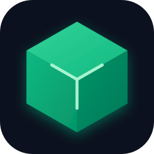

<div align="center">

  

  # BlockHost
  **The Next-Generation Minecraft Server Engine & Management Platform for Windows**

  [](https://github.com/Yugraj20/BlockHost/releases)
  [](https://buymeacoffee.com/yugraj20)
  [](https://github.com/Yugraj20/BlockHost/releases)
  [](LICENSE)
  [](https://www.electronjs.org/)
  [](https://www.typescriptlang.org/)
  [](https://react.dev/)

  <p align="center">
    <b>Host, manage, mod, and play with friends in seconds.</b><br />
    No complicated port-forwarding. No separate agent processes. Pure native Windows performance.
  </p>

  <p align="center">
    <a href="https://yugraj20.github.io/BlockHost/"><b>🌐 Live 3D Website & Demo</b></a> •
    <a href="https://github.com/Yugraj20/BlockHost/releases/latest"><b>Download Installer (.exe)</b></a> •
    <a href="#-key-features"><b>Features</b></a> •
    <a href="#-quick-start"><b>Quick Start</b></a> •
    <a href="#-tech-stack"><b>Tech Stack</b></a> •
    <a href="#-development"><b>Development</b></a>
  </p>

  <br />


</div>

---

## ⚡ What is BlockHost?

**BlockHost** is an all-in-one desktop application that transforms your Windows PC into a high-performance, self-hosted Minecraft server station. Whether you're setting up a vanilla survival server for friends, a Paper network with custom plugins, or a massive Fabric/Forge modpack, BlockHost takes care of Java runtimes, engine binaries, firewall tunneling, mod management, and automated backups right out of the box.

---

## 🌟 Key Features

### 🎮 7 Server Software Engines
- Official release scraping and automated 1-click downloads for:
  - **Vanilla**: Official Mojang Java Edition server runtime.
  - **Paper**: High-performance Spigot fork with PaperMC Fill v3 API integration.
  - **Purpur**: Advanced gameplay customization and drop-in Paper replacement.
  - **Fabric**: Lightweight, bleeding-edge modular modding.
  - **Quilt**: Community-driven modular loader compatible with Fabric mods.
  - **Forge**: The legendary standard for large content modpacks.
  - **NeoForge**: The modern evolution for Minecraft 1.20.1+ and 1.21+.

### ☕ Automated Adoptium Java Runtime Manager
- **Zero manual Java installs**: Automatically queries and downloads **Eclipse Temurin OpenJDK (Java 8, 17, 21, or 25)** based on Minecraft version compatibility.
- Seamlessly switches runtimes per-server without modifying your global Windows `PATH`.

### 🌐 Built-In In-Process playit.gg Tunneling
- **Zero port forwarding required**: Built-in implementation of the official `playit-agent` proto v2 directly inside the Electron background process.
- Instant public domain assignment (`*.gl.joinmc.link`) with zero external CLI executables or daemon dependencies.
- Real-time latency tracking, byte meters, connection diagnostics, and automated heartbeat watchdog recovery.

### 🧩 Seamless Modrinth Ecosystem
- Browse, install, and update **Mods, Plugins, Datapacks, and `.mrpack` Modpacks** directly from the UI.
- Automatic dependency resolution, version compatibility checks, and 1-click addon updates.

### 📊 Real-Time Server Telemetry & Console
- **Interactive Console**: Live terminal stream with color-coded log levels, quick command macros, and tab completion.
- **Sparklines & Metrics**: Real-time graphs for CPU utilization, JVM heap memory, allocated RAM, active player count, and exact Tick-Per-Second (TPS 20.0).

### 👥 Player & Access Management
- **Mojang UUID Resolution**: Automatic avatar and UUID lookup via official Mojang APIs.
- **Access Control**: Live Whitelist, Ban Manager (Player & IP bans with expiry reasons), and Operator permissions (OP levels 1–4).

### 🗄️ Sandboxed File Manager & In-App Code Editor
- In-browser Monaco-grade text editor with syntax highlighting for `server.properties`, `bukkit.yml`, `paper-global.yml`, JSON, YAML, and configs.
- Automatic `.bak` safety snapshots created before saving edits.
- Integrated ZIP archiving and extraction with path-traversal sandboxing.

### 🛡️ Automated Backups & Cron Scheduler
- Live server hooks: executes `save-off` and `save-all flush` before archiving to prevent corrupted chunks.
- Scheduled recurring jobs (Backups, Restarts, Custom Commands) powered by cron expressions.
- Safe rollback restore with pre-restore safety checkpoints.

### 🎛️ Proportional 5-Part RAM Allocator
- Dynamically detects your system's hardware RAM and partitions memory into 5 clean, mathematically aligned milestones (e.g., `1 GB`, `4 GB`, `8 GB`, `12 GB`, `16 GB`).
- 1-click snap alignment with pre-configured **Aikar's G1GC JVM Flags** for garbage collection stutter prevention.

---

## 🚀 Quick Start

### 1. Download & Install
Download the latest Windows installer:
👉 **[Download BlockHost Setup 0.1.0-beta.exe](https://github.com/Yugraj20/BlockHost/releases/latest)**

Run the installer, pick your preferred installation directory, and launch **BlockHost**.

### 2. Create Your First Server
1. Click **Create Server** in the navigation bar.
2. Choose your preferred engine (**Paper**, **Vanilla**, **Fabric**, etc.) and Minecraft version.
3. Select your RAM allocation using the 5-part slider.
4. Click **Create & Launch** — BlockHost automatically provisions the server files, installs the matching Java runtime, and accepts the EULA.

### 3. Invite Friends Instantly
1. Navigate to the **Network & Tunneling** tab.
2. Click **Enable playit.gg Tunnel**.
3. Copy your unique `xyz.gl.joinmc.link` address and share it with your friends!

---

## 🛠️ Tech Stack

| Layer | Technologies |
|---|---|
| **Shell & Core** | [Electron 33](https://www.electronjs.org/), [Node.js 20](https://nodejs.org/) |
| **Frontend Framework** | [React 18](https://react.dev/), [TypeScript](https://www.typescriptlang.org/), [Vite 5](https://vitejs.dev/) |
| **State Management** | [Zustand](https://github.com/pmndrs/zustand) |
| **Styling & UI** | [Tailwind CSS](https://tailwindcss.com/), [Lucide React](https://lucide.dev/) |
| **Networking & Tunneling** | Native UDP/TCP Playit Protocol v2, Adoptium API, PaperMC Fill v3 API |
| **Installer & Packaging** | [electron-builder](https://www.electron.build/), NSIS (Nullsoft Scriptable Install System) |
| **Test Suite** | [Vitest](https://vitest.dev/) |

---

## 💻 Development & Building from Source

### Prerequisites
- Windows 10 or 11 (64-bit)
- [Node.js](https://nodejs.org/) v18.0.0 or higher
- Git

### Installation
```bash
# Clone the repository
git clone https://github.com/Yugraj20/BlockHost.git

# Navigate into the project folder
cd BlockHost

# Install dependencies
npm install
```

### Development Mode
Launch the application in development mode with Hot Module Replacement (HMR):
```bash
npm run dev
```

### Running Tests
Execute the Vitest unit and live integration test suite:
```bash
npm run test
```

### Building the Windows Installer
Compile and package the standalone NSIS installer executable:
```bash
npm run build:win
```
The output executable will be generated inside the `dist/` directory:
`dist/BlockHost Setup 0.1.0-beta.exe`

## ☕ Support the Project

If you love using BlockHost and want to support ongoing maintenance and new features, consider buying a coffee:

[](https://buymeacoffee.com/yugraj20)

---

## 📄 License

This project is licensed under the **MIT License** — see the [LICENSE](LICENSE) file for details.

---

<div align="center">
  <sub>Developed by <a href="https://github.com/Yugraj20">Yugraj Singh Sekhon</a>. BlockHost is not affiliated with Mojang Studios, Microsoft, or playit.gg.</sub>
</div>
